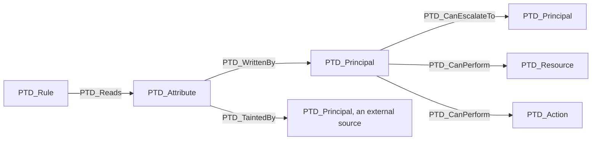

# Concepts

What every engine of Petard has in common: the question it asks, what a claim rests on, how a
match is reported and shown, and where the patterns live. [opa.md](opa.md) and
[zanzibar.md](zanzibar.md) say how each engine applies it.

## The question

An authorization system answers who has access now. OPA evaluates a decision against a request
and the data it holds, and SpiceDB answers a check against the relationships it stores. Petard
reads the same policy or schema and asks who can change that answer without touching the policy
itself. The answer can change while the policy stays the same, so Petard reads the policy together
with what it decides on:

- the data a decision reads, and who can write it: a role in a user's record, the members of a
  group, the owner of a document;
- the parts of the request a decision trusts, and who sets them: a flag that says the request is
  exempt, a header the caller writes, a group name an identity provider copies;
- the relationships a check goes through, and what they carry: in a SpiceDB schema, the context
  a caveat reads, which whoever writes the relationship can fill in.

A policy that judges the object it is handed and reads nothing stored, an admission controller or
a configuration check, gives the question little to work on, and the report says so.

## Decisions and subjects

A decision is what an enforcement point asks for: a rule of a Rego policy, or a permission of a
SpiceDB schema checked on an object. The subject is who asks: the part of the request that names
the requester in Rego, the subject of the check in SpiceDB.

Rego has no fixed place for either. Petard takes the rules a policy annotates as entrypoints or
the ones named on the command line, and otherwise the rules no other rule uses. It recognizes the
subject from the shape of the request unless it is declared, at a level of confidence the report
prints. A SpiceDB schema declares its permissions and the subjects each relation allows, and a
validation file holds the checks asked of them.

## What no policy says

Three facts a claim can rest on are in no policy:

- who can write which document, which lives in an API, a pipeline, or whatever merges a
  configuration repository: the write model;
- who sets each part of the request, which is decided by the product that builds it: the
  enforcement point;
- who can become an identity a decision trusts, and what bounds an authority a delegated agent
  asks for: the identity model, declared next to the enforcement point.

For a Rego policy each is a file Petard reads, given with `-write-model` and `-pep`.
[opa.md](opa.md#what-holds-a-claim-up) has the details. For a SpiceDB schema, who writes a
relation and with which context is decided by the application that writes to SpiceDB, and
Petard reads no declaration of it.

## Findings and candidates

A match is a finding when everything it rests on is known: the policy itself, or a declaration
that names who writes or who sets. Otherwise it is a candidate. A candidate that rests on who
writes a path of a policy names the path, the report lists it as a question, and `-questions`
writes those questions as a write model to fill in. Every match on a SpiceDB schema is a
candidate, for the reason above.

`-fail-on` decides which of them fail a run: findings by default, candidates as well with `any`.

## Witnesses

A match comes with a witness when Petard finds one in what it read, so a reader can repeat it
with the product's own tools.

- An escalation in a policy is `proven by` a request: the decision refuses it as the data stands
  and grants it once the write is made. OPA answers both questions, and `-tests` writes the pair
  as an opa test that fails while the escalation is open.
- A caveat parameter of a schema is `shown by` a check of the validation file: the check goes from
  no to yes once a relationship carries the value. Written into the file that way, `zed validate`
  fails on the assertion the check came from.

## The registry

Each pattern is a file in [`taxonomy-registry/`](../taxonomy-registry/README.md), versioned as
data: what it looks for signal by signal, what it needs to run, the false positives it knows and
what each has been held to, and what closes it. The engine reads its identity, its category and
its verdict from there, and runs the case of each declared false positive in the test suite.

A pattern is one instance of a category that does not depend on the engine.
SELF-ASSERTED-EXEMPTION, whoever is checked supplies the value that lifts the check, is
`PTD-OPA-009` in Rego, where a request says it is exempt, and `PTD-ZAN-001` in a SpiceDB schema,
where a relationship carries the value the check was meant to bring. A category with no instance
in an engine is declared there, with the reason.

Nothing a linter could find by reading one file goes in. Every pattern says, in its
`not_a_lint_rule` field, why the linter of its language cannot find it.

The patterns travel in the binary, so the two commands that read them work without a checkout:

```
petard patterns
petard explain PTD-ZAN-001
```

## The graph

The escalations Petard finds in a policy leave it as a BloodHound OpenGraph, over
[bhgraph](https://github.com/saluc28/bhgraph): five node kinds and five relationship kinds,
declared in `internal/graph`.



`PTD_CanPerform`, `PTD_WrittenBy` and `PTD_CanEscalateTo` are the three BloodHound may walk.
`PTD_Reads` and `PTD_TaintedBy` are dependencies rather than capabilities, and marking them
traversable would invent paths in the interface that nobody can take. The decision is made in
the model and the schema is generated from it, so the two cannot drift apart.

The kind names and the property keys are a contract. They end up in ingested data and in saved
queries, so renaming one means re-ingesting every graph and rewriting every query that mentions
it. `petard export` reads policies; it does not read SpiceDB schemas.

## How the claims are held

Each engine is checked against something outside its own code. For a policy that is OPA itself,
asked by partial evaluation what is left of a decision once the data is known, a fixture written
by hand with a case and a counter case for each pattern, and worlds generated from a seed with
the truth about each stated beside it. For a Zanzibar model it is SpiceDB itself: the engine's
answers to every check of a validation file are written as assertions, and `zed validate` says
whether SpiceDB gives the same. [opa.md](opa.md#how-the-claims-are-checked) and
[zanzibar.md](zanzibar.md#held-to-spicedb) have the details.
