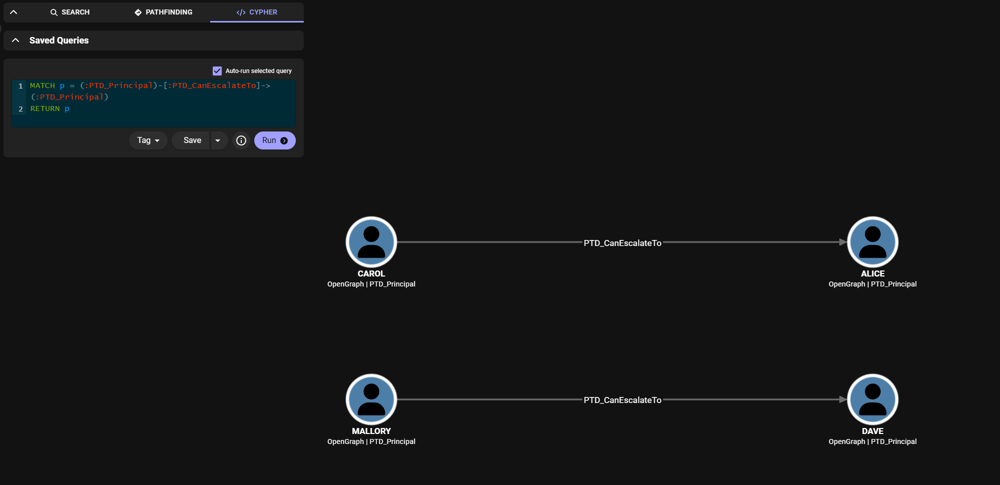
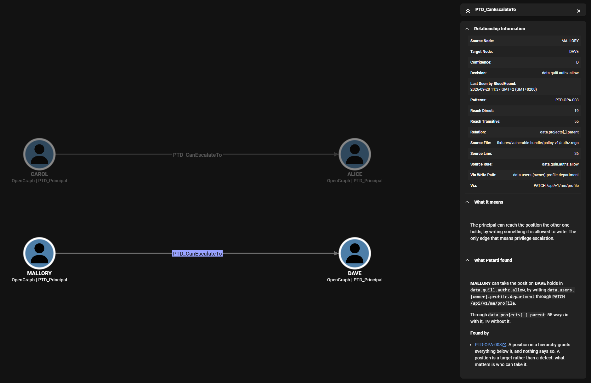
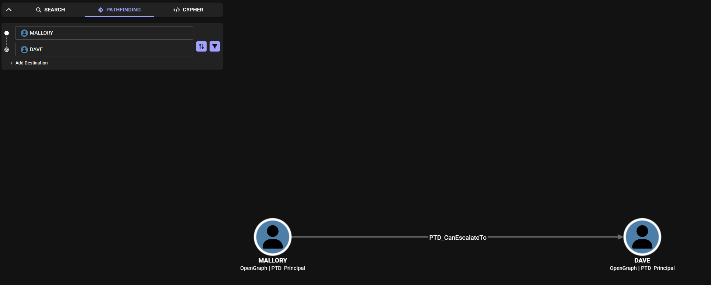
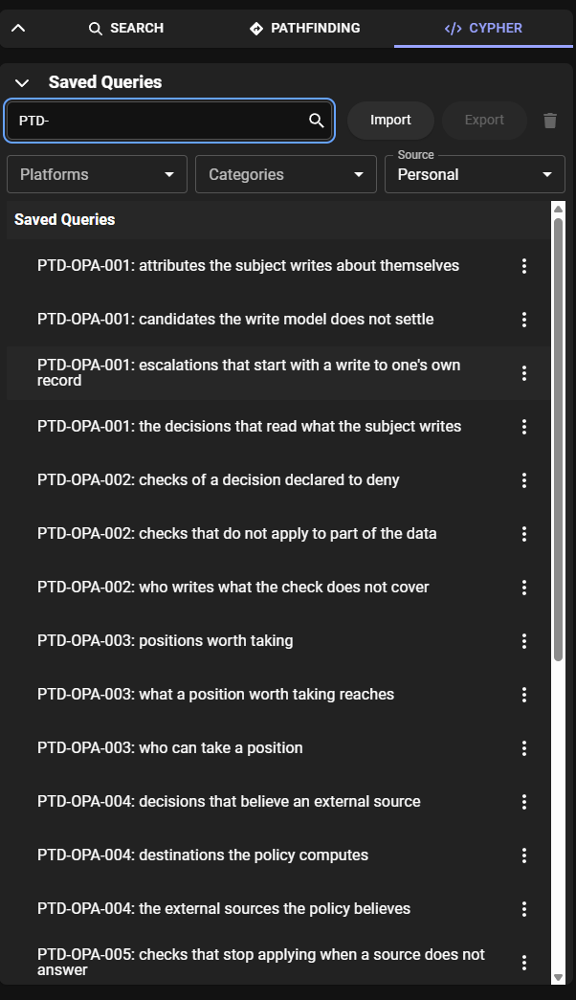

# The OPA engine

How Petard reads a Rego policy, the patterns it applies to it, how to run it on a policy of your
own, and how each claim is checked. [concepts.md](concepts.md) has what every engine shares, and
[ten-minutes.md](ten-minutes.md) takes a public policy from the first run to a finding.

## What it reads

`internal/opaengine` loads a bundle in either Rego syntax, v1 or v0, and records which one it
read. A tool that analyzes somebody else's policies does not get to pick the syntax: every one
of the 51 bundles in the `open-policy-agent/gatekeeper-library` corpus parses as v0 and none of
them as v1, while all 28 in `open-policy-agent/contrib` parse as v1. A bundle that is half of
each loads as neither, with an error naming every file involved. `-rego-v0` and `-rego-v1` fix
the syntax instead.

A path can be a Rego file, a directory holding them, or a bundle archive, such as the
`bundle.tar.gz` that `opa build` writes, whose policies and data are read the same way:

```
petard analyze bundle.tar.gz
```

A running OPA can be given in place of a path. Petard reads it over the API, read only, and
analyzes what the server runs rather than a checkout that may have moved on: the policies, and the
data under each document the decisions read. It never asks the server to decide anything. A bearer
token, if the server needs one, is read from `$PETARD_OPA_TOKEN`:

```
petard analyze http://localhost:8181
```

Concrete data is what turns a pattern into a finding about named principals, since the engine
evaluates each decision partially against it. A bundle that keeps its data in `data.json`,
`data.yaml` or `data.yml` files next to the policies needs nothing more, since those are read the
way OPA reads them; `-data` names other documents in their place.

Analyzing a policy never calls the endpoints written in it. A call to `http.send` stays inside
the residual condition, where it says something true: that the decision cannot be settled from
the data alone.

## Decisions

The starting points are the decisions: the rules the policy annotates as entrypoints, plus any
the caller declares. Whole families of Rego annotate nothing, and that same corpus has no
`# METADATA` block at all across its 142 files. When nothing names a decision, the run takes the
rules no other rule of the bundle uses (`Bundle.Roots`), since only something outside the policy
can be asking for them. The uses are those of the rule graph OPA's compiler builds, which follows
a reference with a variable in it to every rule it can reach, and a test neither uses a rule nor
becomes a decision. On three products that query OPA from their own code, those rules are what
the code queries: SPIRE queries `data.spire.result` (`pkg/server/authpolicy/policy.go:113` at
e599ab8), Fleet `data.authz.allow` (`server/authz/authz.go:40` at e1a6883b), and Chef Automate
three of the four rules its authorization policy leaves unused
(`components/authz-service/engine/opa/opa.go:36` to `:38` at 61ca031). The fourth there,
`data.authz.authorized`, and a constant Fleet declares and never reads become decisions nobody
queries, and whatever the report says about them is about a rule the enforcement point does not
ask. The report says the decisions were inferred, and `-entrypoint` replaces them:

```
petard analyze -entrypoint authz/allow path/to/policy
```

A rule called `deny`, `violation` or `warn`, alone or followed by an underscore and a name, is
inferred to deny: those are the names conftest reads as a failure or a warning
(`policy/engine.go:47` and `:48` at v0.71.0). An enforcement point that refuses the request as
soon as a rule holds or collects anything, the way Gatekeeper reads `violation`, declares that
side instead, and which side a read is on is then counted from the refusal:

```
petard analyze -deny-entrypoint k8sallowedrepos/violation path/to/policy
```

A declared decision can also be the document that rules with a reference in their head build
together, such as `authzen/allow` for rules written `allow["decision"]`, or one field of what a
rule returns. A rule that answers `{"allowed": ..., "violations": [...]}` is defined whatever it
says, and AWX reads `allowed` out of it, so the decision to declare there is
`aac/aap/policy/owner_scope/allowed`. The part of the request that names the requester can be
declared too, rather than recognized:

```
petard analyze -entrypoint aac/aap/policy/owner_scope/allowed \
  -subject input.created_by.username -data path/to/config path/to/policy
```

So can the parts that name what is asked for, with `-action` and `-resource`, when the request
carries them under names that do not give them away:

```
petard analyze -resource input.request.remainder_path path/to/policy
```

A decision whose default is a value other than `true` or `false`, `default result := {"decision":
"deny"}` or `default verdict := "scan"`, is defined for every request, the ones it refuses
included. Which of its answers is a grant is in what the enforcement point reads out of the value,
and the policy does not say. Such a decision is taken to grant where it answers anything other
than its default, and the report names it and that reading under `How much to trust this`. Where
a field of the answer is `true` or `false`, that field is the decision to declare. Where the
answer is one value of several, the ones that grant are declared with the decision, one
`-entrypoint` for each, and it is then asked for each of them: OPA is given the decision unified
with the answer, which drops the default and the rules that give another answer, and those rules
are read on the side that refuses.

```
petard analyze -entrypoint gate/verdict=allowed -entrypoint gate/verdict=clean path/to/policy
```

A product that asks for decisions can be declared once instead, in the format of
[`pep-registry/`](../pep-registry/README.md): the rules it asks for by name and the side each lands
on, where it puts the requester, and who sets each part of the request. Each claim in a
declaration carries the file and line or the page of documentation it was read from. `-pep`
names one, and the bundle is asked which of its rules carry those names:

```
petard analyze -pep spacelift-login path/to/login.rego
```

## What the analysis reports

From the decisions it walks the rules they depend on, following calls into functions and leaving
alone the expressions that mock the world with a `with` modifier, and reports:

- every place a decision reads `data`, with the normalized path, the reference as the author
  wrote it, the file and the line, and whether the read sits under a negation. A function handed
  a document reads the field it names: `privileged(user)` testing `user.role`, called with
  `data.users[input.user]`, reads `data.users[input.user].role`, in the function and for the
  decisions that reach it through that call
- who chooses the document each read lands on: the caller, other data, a builtin, or nobody
  the analysis can name
- the values a decision depends on that the policy did not compute, such as the body of an
  HTTP response, and which decisions each of them reaches
- every place a decision holds a part of the request against a value the policy writes, such as
  `input.session.teams[_] == "DevOps"` or `not input.emergency`, and what the check holding does
  to each decision: grants, refuses, or lifts a refusal. A check crossed by a negation on the way
  down from the decision lands on the side that grants inside something that would refuse, which
  is how an exemption reads, and also how meeting a condition of a rule that refuses reads: who
  sets the part of the request is what tells the two apart
- the shape of the request, with the level of confidence it was recognized at, which runs from
  a declaration down to a guess about field names and travels with the answer. Which field names
  the requester is decided where the request is built, so it can be declared too

Given concrete data it also evaluates every decision partially, and reports what is left of each
one once the documents are known. It is also how a position in a hierarchy gets a number: by
asking OPA what the decision still depends on, instead of walking the relation ourselves and
getting an answer the policy would not agree with.

The summary leads with the escalations, then counts the findings and the candidates by pattern,
and ends with how much to trust it. `-v` adds the evidence under it: every read with its file and
line, the document each write changes and the value it puts there, what each decision is left to
check once the data is concrete, and every place to go and look.

## The patterns

Thirteen patterns apply to Rego. These are one-line glosses; `petard explain <id>` prints one in
full, and its file in `taxonomy-registry/opa/` is the source of truth down to what it has been held
to.

| ID | What it looks for |
|---|---|
| `PTD-OPA-001` | the subject writes an attribute the policy reads to decide about them |
| `PTD-OPA-002` | a deny rule is silent for part of the data, so the check does not apply there |
| `PTD-OPA-003` | a position in a hierarchy grants everything below it, and nothing says so |
| `PTD-OPA-004` | a decision depends on an external source, so whoever controls it decides |
| `PTD-OPA-005` | a check that needs an external source stops applying when it does not answer |
| `PTD-OPA-006` | one decision lets a principal write the data another decision grants on |
| `PTD-OPA-007` | a check written with `every` stops applying when its collection is empty |
| `PTD-OPA-008` | a document every request shares decides for anybody who asks |
| `PTD-OPA-009` | a request lifts a check on itself by saying it is exempt |
| `PTD-OPA-010` | a decision grants on a name that anybody able to create a group can pick |
| `PTD-OPA-011` | a decision grants on a runtime identity that anybody able to deploy a workload can assume |
| `PTD-OPA-012` | a decision grants on a resource matched so loosely a crafted value reaches a different one |
| `PTD-OPA-013` | a decision grants a delegated agent an authority wider than the one delegated to it |

All of them run against the fixture in `fixtures/vulnerable-bundle`, which holds a case and a
counter case for each, and `fixtures/vulnerable-bundle/EXPECTED.md` declares in words what an
analysis has to find there and what it must not.

Each pattern also declares where it leaves its mark in the exported graph, in `graph.marks`, so
that a saved query asking for `PTD-OPA-002` and the code that writes that id cannot disagree
without a test failing.

## The two chains

Two patterns end in the words privilege escalation, and each draws a `PTD_CanEscalateTo` between
two principals.

`PTD-OPA-001` and `PTD-OPA-003` chain into the first. A principal who can write a single field
reaches the position of a principal who reads a whole subtree, and the edge names the document
to write and the endpoint to write it through. On the fixture that is MALLORY reaching DAVE by
writing their own profile department through `PATCH /api/v1/me/profile`.

`PTD-OPA-006` draws the second. One decision lets a principal write a value that another
decision grants on, so the writer reaches the principal who already holds the position. On the
fixture that is CAROL reaching ALICE by writing the role `editor` through
`PUT /api/v1/users/{id}/roles`: `data.quill.admin.allow` allows the write, and
`data.quill.publish.allow` grants the position on the value written.

Neither value is invented. The engine leaves the document unknown and asks OPA what is left of
the decision, so "some value here works" is an answer from the policy rather than a guess about
it. The same partial evaluation is what puts a number on a position: how many ways into the
decision the relation adds, and how many remain without it.

An escalation also carries a request that proves it by evaluation, when asking the decision finds
one: refused as the data stands, granted once the document holds the value written. On the
fixture MALLORY asks to read `d-t11-1`, granted once their department is `platform` and only
through the hierarchy, and CAROL asks to publish, granted once their roles hold `editor`. These
are the requests `fixtures/vulnerable-bundle/verify/measure.rego` writes by hand, and `opa eval`
repeats either one with a `with` on that one document.

`-tests` writes each of those proofs as an opa test that says the escalation is closed, so it
fails until it is. When a decision of the policy allows the write, as `data.quill.admin.allow`
allows CAROL's, the test asks it too, so it passes once the write is refused, which is how the
registry closes `PTD-OPA-006`, or once the granting decision stops granting.

```
petard analyze -write-model model.yaml -data data -tests escalations_test.rego policy
opa test policy data escalations_test.rego
```

## What holds a claim up

Three facts a claim rests on are in no policy, and each is declared.

Who can write what lives in deployment, in an API, in a pipeline, in whatever merges a
configuration repository. That is the write model in `internal/writemodel`, given with
`-write-model`. Without it a match that rests on who writes a path stays a candidate, and the run
reports how many of the paths the decisions read the model covers, so an empty model is
distinguishable from a clean result. With it, a match becomes a finding that names a principal, a
document and the endpoint the write goes through. The write model also carries where each path
came from. One a person asserted and one a connector discovered are both usable and are not the
same claim, so the edge keeps the difference in `write_confidence`.

A candidate that rests on who writes a path names it. The report lists those paths as questions,
and `-questions <file>` writes them as a write model to fill in, one entry per open path. Answer
each `via`, confirm the principal, and rerun with `-write-model`:

```
petard analyze -data data -questions write-model.yaml path/to/policy
```

When a bundle authorizes its own writes, `-v` lists the branches of a decision that grant on a
write method, and the skeleton appends each as a commented `authorized_by` block. Attaching one to
a writer is how a write allowed by another decision gets declared without writing the block by
hand.

Who sets each part of the request is decided by the product that builds it: the caller, the
product itself, or an issuer it copies from. That is the enforcement point, given with `-pep`.
Without it `PTD-OPA-009`, `PTD-OPA-010`, `PTD-OPA-011` and `PTD-OPA-013` do not run, and the
report says so.

Who can become an identity a decision trusts, and what bounds an authority a delegated agent asks
for, are facts about another layer. That is the identity model, declared on the parts of the
request in the same file as the enforcement point, with `assumable_by` and `bounded_by`.
`petard explain <id>` says which of the three a pattern needs.

Some questions are put to a decision starting from a request it grants, and the engine builds
that request from the policy. A decision that holds a part of the request against something it
computes leaves nothing to build one from, and the report says it could not be asked. `-granted`
gives it a request to start from: a JSON or YAML file holding what the policy reads as `input`,
the one a test of the policy sends or one out of an access log.

```
petard analyze -pep gateway.yaml -granted request.json path/to/policy
```

A request no decision grants is refused, and the report names the decisions that grant each one
given.

## Levels of confidence

Petard reports at the level the request was recognized at, from a declaration down to a guess
about field names, and the level travels with every claim that rests on it:

| Level | The request is |
|---|---|
| `A` | declared, by a `# METADATA` schema, by `-subject`, `-action` or `-resource`, or by the enforcement point |
| `B` | shaped the way the AuthZEN Authorization API standardizes it: subject, action, resource and context |
| `C` | shaped by a known convention of one domain, such as a Kubernetes admission review |
| `D` | recognized by the names of its fields, which is a guess and says so |
| `E` | not recognized, so only the syntactic part of the analysis holds |

An edge measured at level `D` is a hypothesis about which field names the requester, and reads
differently from one measured against a declaration.

## BloodHound

To send an analysis to BloodHound CE, write the policy fixture to disk and export it. The
credentials come from two environment variables, because a token on a command line ends up in the
shell history:

```
petard demo -extract . opa
export BLOODHOUND_TOKEN_ID=...
export BLOODHOUND_TOKEN_KEY=...
petard export -url https://bloodhound.example -install -upload -verify \
  -pep vulnerable-bundle/pep.yaml -write-model vulnerable-bundle/write-model.yaml \
  -data vulnerable-bundle/data -granted vulnerable-bundle/inputs/granted-download.json \
  -granted vulnerable-bundle/inputs/granted-mint.json vulnerable-bundle/policy-v1
```

```
graph: 71 nodes, 84 edges
  3 declared writers name a rule for finding somebody, not somebody, and have no edge
  131 ways of granting depend on something an edge cannot say, and are left out
schema installed, 3 of 5 relationship kinds are traversable
saved queries: 48 added, 0 already there
ingest job 1 started
job 1 processed 1 file(s) with no errors
  MALLORY -> DAVE: pathfinding walks it
  CAROL -> ALICE: pathfinding walks it
2 of 2 escalations are walkable in BloodHound
```

The lines under the count are what the analysis knows and the graph could not hold. A way of
granting that also depends on a second factor, or on another part of the request, is not a
capability somebody simply has, so it gets no edge and is counted.

`-verify` asks the server for a path between the two principals of every escalation in the
payload, with `only_traversable`, and fails if it will not walk one. A graph that claims a path
nobody can take is the single thing this tool must not produce. Without an instance, `-out
graph.json` writes the payload, and BloodHound takes a JSON upload from the interface.

The escalations are edges, so they show up the way any other attack path does.



Select one and the Entity Panel says what was found on that edge: who takes whose position, in
which decision, by writing what and through which endpoint, how many ways in the relation adds,
the request that proves it, at which level the request was recognized, and a link to the file of
the pattern that reported it.



Pathfinding walks them too, which is what `-verify` checks over the API.



Installing also saves 48 Cypher queries, named after the question they ask. They return nodes and
paths, so the answer opens in the graph and in the table view next to it.
[queries/README.md](../queries/README.md) says what they ask for and what the BloodHound backend
will and will not run.



`schema/petard.json` is the extension definition schema that tells BloodHound which of the edges
its pathfinding may walk, what each kind means, and what to show in the Entity Panel. It is
generated from the model and checked by a golden test, so the two cannot disagree.

`petard export` refuses to run when the `opengraph_extension_management` feature flag is off.
With it off, pathfinding answers from the built-in AD and Azure kinds alone and says "path not
found" whether or not the path is there, so `-verify` would report a confident no for the wrong
reason.

`-install` saves the schema and the queries, and never deletes anything. BloodHound keys a saved
query by its name, so a query renamed between two versions of Petard arrives as a second query
and the old one stays: `-prune-queries` removes the ones this build no longer has, naming each
as it goes.

## How the claims are checked

Two fixtures, because they carry two different risks.

`fixtures/vulnerable-bundle/` is a policy with escalation built into it on purpose, written by
hand in both Rego syntaxes, next to an `EXPECTED.md` that declares in words what an analysis has
to find and what it has to stay quiet about. Every pattern gets a case and a counter case there.

It lints clean under `regal`, and that is deliberate. The claim the project makes is that the
code is correct and idiomatic and the defect is somewhere else: in the data somebody can write,
in the key that is missing, in the source that does not answer.

`internal/fixture` generates worlds from a seed and states the truth about each one, which is
what turns "did it find the planted escalation" into a measurement of precision as well as
recall. A pattern that finds everything and invents half of it is unusable in an assessment, and
only generated ground truth makes that visible.

The engine also runs over bodies of Rego written by other people, which do not live in this
repository:

```
petard measure /path/to/corpus/src
```

## What it does not see

It does not decide whether a finding is a problem in your system. A position in a hierarchy is a
target rather than a defect, and the report says who can take it and leaves the judgment to you.

Some shapes of negation are still invisible to the walk. `count(S) == 0` over a comprehension
written inline reads as an ordinary comparison, and `not count(S) > 0` is not read as "empty". An
`and` or an `or` written inside a comprehension, an `every` or a `not` is read like any other
expression, but partial evaluation answers for it with the documents it reads rather than with
the requests that make it hold.
